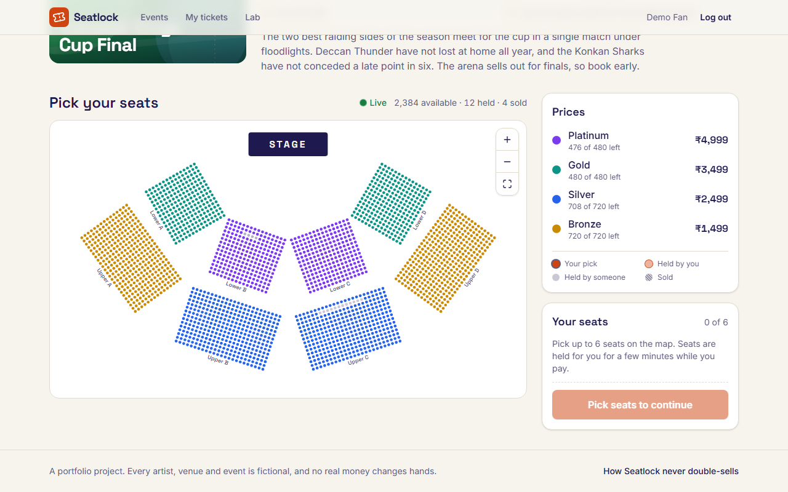
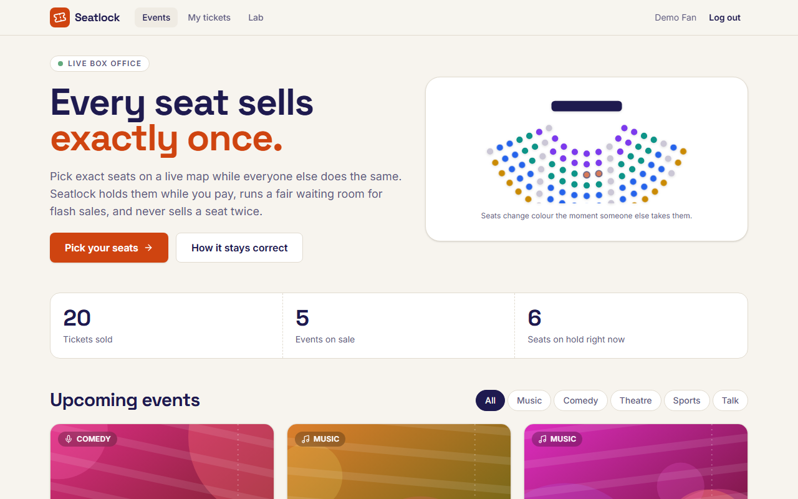
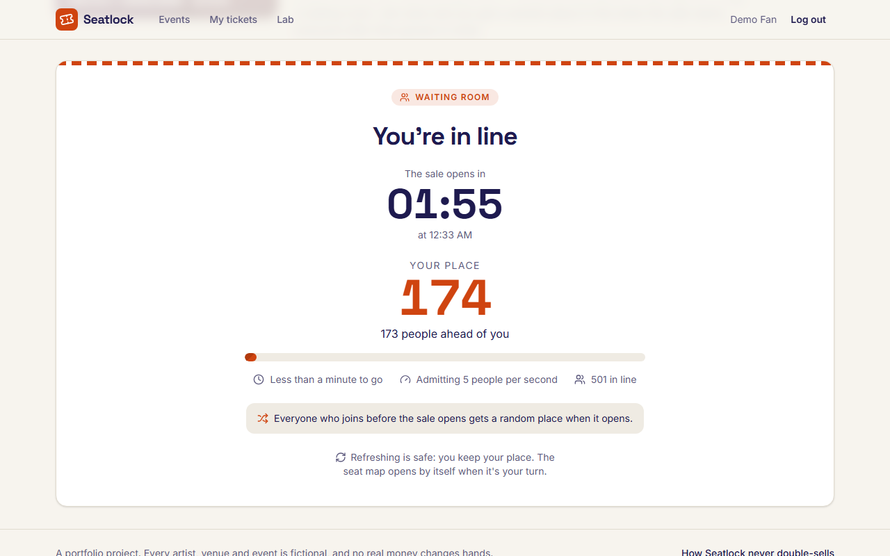
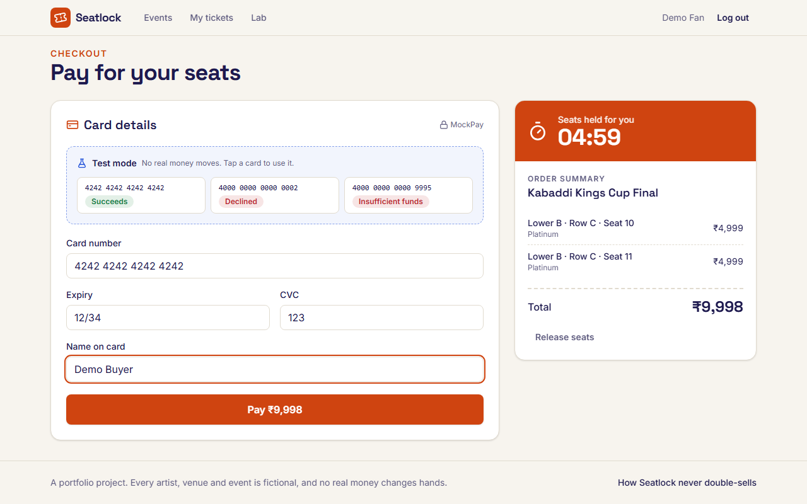
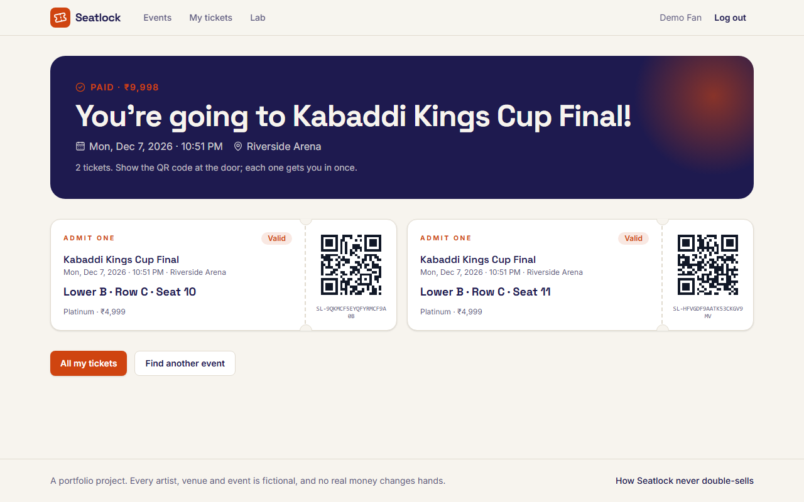
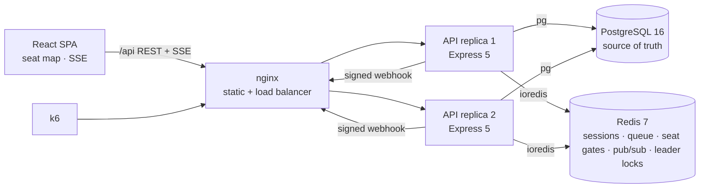

# Seatlock

**A ticket-booking system built for the worst second in ticketing: a sale opens and thousands of people try to buy the same seats at once. It never sells a seat twice.**

Buyers pick exact seats on a live seat map. Seats are held while the buyer pays, a fair waiting room protects flash sales, and payments are confirmed by signed webhooks. Four seat-locking strategies sit behind one interface and are load-tested side by side with k6. After every run, the database is checked against a list of correctness invariants.



| | |
|---|---|
|  |  |
|  |  |

## What it does

- **Live seat map.** An SVG map of up to 2,400 seats, with pan and zoom, keyboard access and tier pricing. It updates over Server-Sent Events as other buyers take seats. If a seat you selected is taken, you're told: "Seat C12 was just taken".
- **Seat holds that expire.** Holding seats starts a countdown (5 min by default). Expiry is lazy: an expired hold counts as free the instant it lapses, and a background sweeper only tidies up.
- **Fair waiting room.** People who arrive before the sale opens get a **random** place when it opens. Later arrivals queue first-come, first-served behind them. Users are admitted at a set rate, and each admitted user gets an HMAC-signed access token valid for 15 minutes.
- **Checkout.** Orders take idempotency keys. The mock payment provider ("MockPay") confirms payments through **HMAC-signed, replay-protected webhooks**, and the browser is never trusted about the result. A declined card can be retried while the hold lasts.
- **Tickets.** Each ticket has a QR code, and there is a door check-in page.
- **Admin console.** Create events (seats are generated from a venue layout), watch a live sales dashboard, and use demo tools: "Reopen sale in N s" and "Simulate crowd".
- **Lab page** (`/lab`). It explains how the system stays correct and shows the committed benchmark results.

Every artist, venue and event is fictional, and no real money is involved.

## Quick start

You need Docker Desktop.

```bash
docker compose -f docker-compose.yml -f docker-compose.stack.yml --profile stack up -d --build
# open http://localhost:8088 and click "Try the demo"
# admin: admin@seatlock.dev / dev-only-admin-password-do-not-reuse
```

This starts nginx, 2 API replicas, Postgres 16 and Redis 7, and seeds 7 events. Use the declined test card `4000 0000 0000 0002` to see a payment fail, then retry with `4242 4242 4242 4242`.

To run it locally for development (Node 22):

```bash
docker compose up -d          # Postgres :55434, Redis :56381
npm ci
npm run db:migrate && npm run seed
npm run dev                   # web http://localhost:5175, api :4200
```

## Architecture



- **Postgres is the single source of truth.** Every query on the hot path is hand-written SQL (`pg`, no ORM), so the locking behaviour is visible and easy to explain.
- **The API replicas share no in-process state.** Redis carries sessions, the queue, pub/sub for live updates, rate limits and leader locks. Only one replica (the lock holder) runs the expiry sweeper and the queue ticker.

## How it never double-sells

All four strategies implement `hold({eventId, userId, seatIds, ttlSec})`:

| Strategy | Core idea | Notes |
|---|---|---|
| `naive` | `SELECT` the seats, then write if they looked free | The bug most first versions ship with. It exists **only in bench mode**, to show what goes wrong. |
| `pessimistic` | `SELECT … ORDER BY id FOR UPDATE`, check, then write | Locking in id order means no deadlocks. Buyers queue on the row locks. |
| `conditional` (default) | One `UPDATE … WHERE id = ANY($ids) AND <available> RETURNING id`; roll back unless every row came back | Under READ COMMITTED, Postgres re-checks the `WHERE` against the newest row version, so exactly one buyer wins each seat. |
| `redis` | An all-or-nothing Lua script claims the seat "gates" in Redis, then runs the same conditional `UPDATE` as a safety net | Losing buyers are turned away by Redis, without starting a Postgres transaction. |

**Defence in depth.** No single layer is trusted. The strategy decides who holds a seat. The payment webhook sells only rows where `hold_id = $hold AND status = 'held'`, and checks that the row count matches. A `UNIQUE (event_seat_id)` constraint on tickets is the last line of defence. When the naive strategy promises a seat twice, that constraint is what turns the second sale into a refund.

The full design is in [`docs/DESIGN.md`](docs/DESIGN.md). Its decisions log records every deviation and trade-off.

## Benchmarks

Full results are in [`loadtest/results/SUMMARY.md`](loadtest/results/SUMMARY.md), with the raw k6 exports in [`loadtest/results/raw/`](loadtest/results/raw/). Re-run them with `bash loadtest/run-bench.sh`.

**Correctness: every safe-strategy run passed every invariant.** After each run, Postgres is checked for all of these:
- no seat with two tickets;
- no sold seat without a ticket;
- no ticket on an unsold seat;
- every paid order has all its tickets and the right amount;
- no two holds on one seat at the same time.

| Scenario | Strategy | Hold attempts | Held (201) | Rejected (409) | Tickets sold | Invariants |
|---|---|--:|--:|--:|--:|---|
| Hot seat: 1,000 users, same 4 seats, same instant | naive | 1,000 | 1 | 999 | – | pass |
| | pessimistic | 1,000 | 1 | 999 | – | pass |
| | conditional | 1,000 | 1 | 999 | – | pass |
| | redis | 1,000 | 1 | 999 | – | pass |
| Flash sale: 2,000 users, 10,000 seats, up to 120 s | naive | 2,813 | 794 | 210 | 1,212 | **5 seats double-promised**, 1 customer paid, then refunded |
| | pessimistic | 6,305 | 3,073 | 3,085 | 5,409 | pass |
| | conditional | 5,458 | 2,163 | 1,512 | 3,624 | pass |
| | redis | 6,487 | 2,100 | 1,497 | 3,442 | pass |

**Waiting room.** 3,000 users joined within 5 s, all 3,000 were admitted at 200/s, and **none** was admitted out of order.

On the hot seat, latency ranks the strategies as expected. The p95 hold latency was 5.3 s for redis, 6.5 s for conditional, 8.2 s for pessimistic and 8.8 s for naive.

**Read the speed numbers with care.** Everything ran on one laptop (i7-1195G7, 8 threads): k6, nginx, both API replicas, Postgres and Redis. An unrelated ML training job was also using about 90% of the CPU. In the flash sale, all 2,000 virtual users downloaded the 10,000-seat map at the same instant. Many requests timed out and many virtual users gave up early, as the summary's cautions list. The correctness results don't depend on speed; the latency and throughput figures do.

## Security

- Passwords are hashed with argon2id, and login timing doesn't reveal whether an email exists. Sessions are opaque 256-bit tokens, stored server-side only as a SHA-256 hash, in httpOnly SameSite cookies.
- **CSRF:** every non-GET request from a foreign `Origin` is rejected. Bearer-token clients are exempt.
- Rate limits back onto Redis, and the redirect after login is protected against open-redirect tricks (tested against encoded, control-character and dot-segment inputs).
- Webhooks are HMAC-SHA256 signed with a timestamp, checked in constant time, rejected after 300 s, and de-duplicated by event id inside the same transaction that applies them.
- Card numbers are never stored or logged, only the last 4 digits. Logs redact passwords, tokens, cookies and secrets.
- The API container runs as non-root. The site is served with CSP and `X-Frame-Options`.

## Testing

```bash
npm run typecheck && npm run lint
npm test            # shared 30 · api 337 · web 161, against real Postgres and Redis
npm run test:e2e    # Playwright: book, pay, decline, retry, release
```

Race tests fire hundreds of concurrent holds at real Postgres and Redis. Each safe strategy must produce exactly one winner, and the naive strategy must be shown to double-promise. CI (GitHub Actions) runs typecheck, lint, the test suites and the build against Postgres 16 and Redis 7.

## Project structure

```
apps/api/        Express 5 API: booking strategies, payments, waiting room, admin, SSE
apps/web/        React 19 + Vite + Tailwind 4: seat map, checkout, admin, Lab
packages/shared/ zod contracts, error codes, seat geometry, money helpers
loadtest/        k6 scenarios, run-bench.sh, committed results
infra/           nginx config
docs/            design document, plan, screenshots
```

## Tech

TypeScript, React 19, Vite, Tailwind CSS 4, TanStack Query, Express 5, node-postgres, ioredis, zod, PostgreSQL 16, Redis 7, Docker Compose, nginx, k6, Vitest, Supertest, Playwright, GitHub Actions.
