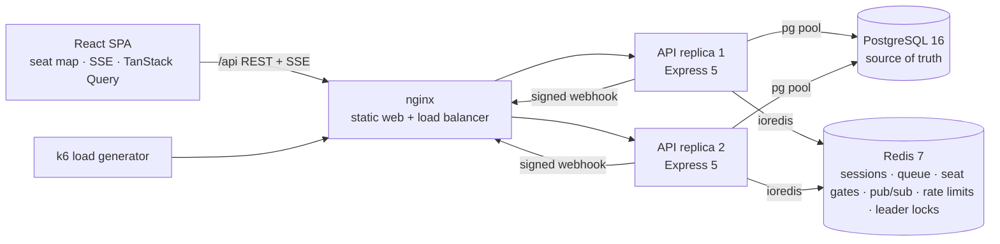

# Seatlock: Design Document

**Seatlock** is a ticket-booking platform built for the worst moment in ticketing: a sale opens and thousands of people try to buy the same seats in the same second. Fans pick exact seats on a live seat map. A fair virtual waiting room protects flash sales. Checkout uses expiring seat holds, idempotent orders and signed payment webhooks. **No seat is ever sold twice.** k6 load tests prove this, and they compare four seat-locking strategies side by side.

Status: v1 design, written 2026-11-07. This document is the source of truth for the build. Record any deviation in the "Decisions log" at the bottom.

---

## 1. Intent

Seatlock is a resume project for internships and placements. Its author is a CSE (Cyber Security) student. "Design Ticketmaster" is one of the most common system-design interview questions, and this project is a working, measured answer to it. An interviewer should be able to try it live in two minutes. The author should be able to defend every design decision with a number.

The hard problem is **correctness under contention**: many concurrent buyers, the same seats, and no double-selling, while the system stays fast and fair. Everything around that core (auth, seat map, checkout, payments, admin, waiting room) should be complete and production-shaped, not stubbed.

### Goals
- A complete, polished full-stack app with real auth, a live seat map, holds that expire, checkout, a mock payment provider with signed webhooks, tickets with QR codes, an admin dashboard and a waiting room.
- **Four seat-locking strategies behind one interface** (naive, pessimistic, conditional, Redis). Benchmarks run each one under identical load and check the results against database invariants.
- **Defence in depth.** Correctness never relies on a single layer: the strategy, hold ownership checks and a `UNIQUE` constraint on tickets all protect it.
- Horizontal scaling: two API replicas behind nginx share no in-process state. Correctness lives in Postgres, coordination in Redis.
- Security hygiene: argon2id, httpOnly session cookies, an Origin check against CSRF, rate limits, HMAC-signed webhooks with replay protection, and idempotency keys.
- Engineering hygiene: strict TypeScript, zod-validated inputs, unit, integration (real Postgres and Redis) and race tests, a Playwright e2e test, CI, Docker, Prometheus metrics, and a README with architecture and **measured** numbers.

### Non-goals (v1)
Real payment providers, email sending, OAuth or social login, resale or transfer of tickets, multi-currency, seat-map editing in the browser (venues are defined as JSON), i18n, and multi-region deployment.

### Anti-goals (failure even if it "works")
- **Any oversold seat in any benchmark run of a safe strategy.** The only strategy allowed to misbehave is `naive`, and only in bench mode, where it exists to show what goes wrong.
- Fake numbers. Every number in the README and the Lab page comes from a committed results file produced by `loadtest/run-bench.sh`, together with the hardware it ran on.
- Real artists, real venues, real brands or copied event text. All seed content is original and fictional.
- Assets loaded from CDNs. Fonts and icons are bundled and self-hosted.
- Buttons that do nothing, lorem ipsum, or TODO-stubbed features in the shipped UI.
- Hard-coded secrets, or logged passwords, session tokens, card numbers or webhook secrets.
- Flaky tests, and tests that mock the thing they are testing. Race tests use real Postgres and Redis.

---

## 2. Users & core journeys

Roles: **guest**, **user** and **admin**.

1. **Browse.** `/` shows a hero, live stats (tickets sold, events on sale), a grid of upcoming events with generated poster art, and a "Try the demo" button (one-click login as the demo user).
2. **Pick seats.** `/events/:slug` shows event details and the seat map. Seats are colored by price tier, and seats that are held or sold are greyed out. The map updates **live over SSE** as other people grab seats. Click to select up to `maxSeatsPerOrder` seats. A selection bar shows the seats and the total. **Hold seats** returns either a hold or a clear "2 of your seats were just taken" message, with those seats flashing.
3. **Checkout.** `/checkout/:holdId` shows a countdown for the hold (5 minutes by default), the order summary and the MockPay card form with the test cards listed. Pay → "Processing…" → confirmation `/orders/:id` with tickets and QR codes. A declined card shows the reason and lets the user retry while the hold lasts.
4. **Flash sale with waiting room.** For a queue-enabled event, the event page shows the waiting room instead of the map: the sale countdown, the user's place in line, a progress bar and an ETA. People who join **before** the sale opens get a random place when it opens. Later arrivals queue first-come first-served behind them. When the user is admitted, the seat map opens and stays usable for a 15-minute access window.
5. **My tickets.** `/tickets` lists orders and tickets with QR codes and their status.
6. **Admin.** `/admin` lists events and has a create-event form (venue, times, tier prices, queue settings). `/admin/events/:id` is a live dashboard: available, held and sold counts, revenue, active holds, queue length and admitted count, recent orders, and a holds-per-second sparkline. Demo tools: **Reopen sale in N seconds** and **Simulate crowd** (adds N clearly labelled bot entries to the waiting room). `/admin/checkin` checks in a ticket code at the door.
7. **Lab.** `/lab` explains how the system works (architecture diagram, the four strategies) and shows the committed benchmark results as tables and bar charts.

---

## 3. Architecture



- **Postgres is the single source of truth** for seats, holds, orders and tickets. Every hot-path query is hand-written SQL (`pg`, no ORM) so it can be read and defended.
- **Redis** holds sessions, the waiting-room queue, the seat gates used by the `redis` strategy, pub/sub for live seat updates, rate-limit counters, idempotency records and leader locks.
- **Background loops** (the hold-expiry sweeper and the queue admission ticker) run in every API process, but only the instance holding a Redis leader lock (`SET NX PX`, renewed) does the work.
- **Live updates.** After a commit, the API publishes seat changes to `sl:ev:{eventId}`. Every API instance `PSUBSCRIBE`s `sl:ev:*` and fans the changes out to its SSE clients, batched every 200 ms.
- **MockPay** is a simulated external payment provider. It lives in its own module and has its own secret. It confirms card payments after a random 300–900 ms delay, then calls the API's webhook URL **over HTTP** with an HMAC signature. The API never trusts the browser about payment results.

### Ports & names
| Thing | Value |
|---|---|
| Web (Vite dev) | 5175 (proxies `/api` → 4200) |
| API (dev) | 4200 |
| Postgres | 55434 → 5432 (`seatlock`/`seatlock`, db `seatlock`, test db `seatlock_test`) |
| Redis | 56381 → 6379 (dev DB 0, tests use DB 1+) |
| Full stack (nginx) | 8088 |
| Package names | `@seatlock/api`, `@seatlock/web`, `@seatlock/shared` |

---

## 4. Tech stack

TypeScript (strict, ESM) everywhere. Node 22, npm workspaces.

- **API:** Express 5, `pg` 8, `ioredis` 5, `zod` 3, `@node-rs/argon2`, `cookie-parser`, `helmet`, `pino` + `pino-http`, `prom-client`. Dev runs on `tsx` and production builds with `tsup` (bundling `@seatlock/shared`).
- **Web:** React 19, Vite 6, Tailwind CSS 4 (`@tailwindcss/vite`), React Router 7 (library mode), TanStack Query 5, `qrcode`, `lucide-react`, and self-hosted fonts via `@fontsource-variable/*`. Charts are small hand-written SVG components with no chart library.
- **Tests:** Vitest, Supertest, Playwright (one e2e journey).
- **Infra:** Docker Compose (`postgres:16-alpine`, `redis:7-alpine`, API image, `nginx:alpine`, `grafana/k6`), with GitHub Actions for CI.
- **Migrations:** plain SQL files in `apps/api/migrations/NNN_name.sql`, applied in order by `src/scripts/migrate.ts` and tracked in `schema_migrations`.

**Why `pg` instead of Prisma (unlike the author's other two projects):** the whole point here is the exact SQL on the hot path, including the locking clauses, conditional `UPDATE … RETURNING`, CTEs and error codes. An ORM would hide it.

---

## 5. Data model (migration `001_init.sql`)

```sql
CREATE EXTENSION IF NOT EXISTS citext;

CREATE TYPE user_role    AS ENUM ('user','admin');
CREATE TYPE seat_status  AS ENUM ('available','held','sold');
CREATE TYPE hold_status  AS ENUM ('active','converted','released','expired');
CREATE TYPE order_status AS ENUM ('pending_payment','paid','failed');

CREATE TABLE users (
  id            uuid PRIMARY KEY DEFAULT gen_random_uuid(),
  email         citext UNIQUE NOT NULL,
  name          text NOT NULL,
  password_hash text NOT NULL,
  role          user_role NOT NULL DEFAULT 'user',
  is_bench      boolean NOT NULL DEFAULT false,
  created_at    timestamptz NOT NULL DEFAULT now()
);

CREATE TABLE venues (
  id         uuid PRIMARY KEY DEFAULT gen_random_uuid(),
  slug       text UNIQUE NOT NULL,
  name       text NOT NULL,
  city       text NOT NULL,
  layout     jsonb NOT NULL,          -- VenueLayout (§6)
  capacity   int NOT NULL,
  created_at timestamptz NOT NULL DEFAULT now()
);

CREATE TABLE events (
  id                  uuid PRIMARY KEY DEFAULT gen_random_uuid(),
  slug                text UNIQUE NOT NULL,
  title               text NOT NULL,
  subtitle            text NOT NULL DEFAULT '',
  description         text NOT NULL DEFAULT '',
  category            text NOT NULL DEFAULT 'music',   -- music | comedy | theatre | sports | talk
  venue_id            uuid NOT NULL REFERENCES venues(id),
  starts_at           timestamptz NOT NULL,
  sale_opens_at       timestamptz NOT NULL,
  tier_prices         jsonb NOT NULL,                  -- {"platinum": 499900, ...} paise
  queue_enabled       boolean NOT NULL DEFAULT false,
  admit_rate_per_sec  int NOT NULL DEFAULT 25 CHECK (admit_rate_per_sec BETWEEN 1 AND 10000),
  max_seats_per_order int NOT NULL DEFAULT 6  CHECK (max_seats_per_order BETWEEN 1 AND 10),
  hold_ttl_seconds    int NOT NULL DEFAULT 300 CHECK (hold_ttl_seconds BETWEEN 30 AND 1800),
  poster_hue          int NOT NULL DEFAULT 260 CHECK (poster_hue BETWEEN 0 AND 359),
  listed              boolean NOT NULL DEFAULT true,   -- bench events are unlisted
  created_at          timestamptz NOT NULL DEFAULT now(),
  CHECK (sale_opens_at < starts_at)
);

CREATE TABLE event_seats (
  id           bigint GENERATED ALWAYS AS IDENTITY PRIMARY KEY,
  event_id     uuid NOT NULL REFERENCES events(id) ON DELETE CASCADE,
  section_key  text NOT NULL,
  row_label    text NOT NULL,
  seat_number  int  NOT NULL,
  tier         text NOT NULL,
  price_paise  int  NOT NULL CHECK (price_paise > 0),
  status       seat_status NOT NULL DEFAULT 'available',
  hold_id      uuid,
  held_until   timestamptz,
  order_id     uuid,
  updated_at   timestamptz NOT NULL DEFAULT now(),
  UNIQUE (event_id, section_key, row_label, seat_number),
  CHECK ((status = 'held') = (hold_id IS NOT NULL AND held_until IS NOT NULL)),
  CHECK ((status = 'sold') = (order_id IS NOT NULL))
);
CREATE INDEX event_seats_event_status ON event_seats (event_id, status);
CREATE INDEX event_seats_hold ON event_seats (hold_id) WHERE hold_id IS NOT NULL;
CREATE INDEX event_seats_expiry ON event_seats (held_until) WHERE status = 'held';

CREATE TABLE holds (
  id           uuid PRIMARY KEY DEFAULT gen_random_uuid(),
  event_id     uuid NOT NULL REFERENCES events(id) ON DELETE CASCADE,
  user_id      uuid NOT NULL REFERENCES users(id),
  seat_ids     bigint[] NOT NULL,
  amount_paise int NOT NULL,
  strategy     text NOT NULL,          -- naive | pessimistic | conditional | redis
  status       hold_status NOT NULL DEFAULT 'active',
  expires_at   timestamptz NOT NULL,
  created_at   timestamptz NOT NULL DEFAULT now(),
  ended_at     timestamptz              -- set when converted / released / expired
);
CREATE INDEX holds_user_event_active ON holds (user_id, event_id) WHERE status = 'active';
CREATE INDEX holds_event ON holds (event_id);

CREATE TABLE orders (
  id              uuid PRIMARY KEY DEFAULT gen_random_uuid(),
  user_id         uuid NOT NULL REFERENCES users(id),
  event_id        uuid NOT NULL REFERENCES events(id) ON DELETE CASCADE,
  hold_id         uuid UNIQUE NOT NULL REFERENCES holds(id),
  status          order_status NOT NULL DEFAULT 'pending_payment',
  amount_paise    int NOT NULL,
  failure_reason  text,                -- PAYMENT_DECLINED | HOLD_LOST | SEAT_ALREADY_SOLD | ...
  idempotency_key text NOT NULL,
  created_at      timestamptz NOT NULL DEFAULT now(),
  paid_at         timestamptz,
  UNIQUE (user_id, idempotency_key)
);
CREATE INDEX orders_user ON orders (user_id, created_at DESC);
CREATE INDEX orders_event ON orders (event_id, created_at DESC);

CREATE TABLE payment_intents (       -- owned by the MockPay module
  id           text PRIMARY KEY,      -- 'pi_' + 24 random base32 chars
  order_id     uuid UNIQUE NOT NULL REFERENCES orders(id) ON DELETE CASCADE,
  amount_paise int NOT NULL,
  status       text NOT NULL DEFAULT 'requires_payment', -- requires_payment|processing|succeeded|failed|refunded
  attempts     int NOT NULL DEFAULT 0,
  last4        text,
  failure_code text,
  created_at   timestamptz NOT NULL DEFAULT now(),
  updated_at   timestamptz NOT NULL DEFAULT now()
);

CREATE TABLE webhook_events (         -- dedupe: a webhook event id is processed at most once
  id          text PRIMARY KEY,
  type        text NOT NULL,
  received_at timestamptz NOT NULL DEFAULT now()
);

CREATE TABLE tickets (
  id            uuid PRIMARY KEY DEFAULT gen_random_uuid(),
  order_id      uuid NOT NULL REFERENCES orders(id) ON DELETE CASCADE,
  event_id      uuid NOT NULL REFERENCES events(id) ON DELETE CASCADE,
  event_seat_id bigint NOT NULL UNIQUE REFERENCES event_seats(id) ON DELETE CASCADE, -- last line of defence
  user_id       uuid NOT NULL REFERENCES users(id),
  code          text UNIQUE NOT NULL,  -- 'SL-' + 20 random Crockford base32 chars (100 bits)
  checked_in_at timestamptz,
  created_at    timestamptz NOT NULL DEFAULT now()
);
CREATE INDEX tickets_user ON tickets (user_id);
```

**Effective seat status.** Holds expire lazily. Every reader and every strategy treats `status='held' AND held_until <= now()` as **available**. A sweeper tidies expired holds every 5 s, but correctness never depends on it.

---

## 6. Venues & seat maps

`VenueLayout` (stored in `venues.layout`, defined in `@seatlock/shared`):

```ts
type VenueLayout = {
  width: number; height: number;                 // SVG viewBox units
  stage: { x: number; y: number; w: number; h: number; label: string };
  tiers: { key: string; name: string }[];        // ordered most → least expensive
  sections: {
    key: string; name: string; tier: string;
    rows: number; seatsPerRow: number;
    x: number; y: number;                        // top-left of row A, seat 1
    angle: number;                               // degrees, rotation about (x, y)
    rowLabelStart?: string;                      // default 'A'; labels A..Z, AA..
  }[];
};
```

The seat pitch is 10 units and the seat radius 3.6. Seat `(row r, number n)` sits at `(x + (n-1)*10, y + r*10)` rotated by `angle` around `(x, y)`. When an event is created, its `event_seats` are materialised from the layout in one bulk `INSERT … SELECT FROM unnest(...)`, with each seat priced from `tier_prices[section.tier]`.

Seed venues (original, fictional):
| slug | name | city | seats |
|---|---|---|---|
| `lotus-hall` | Lotus Hall | Pune | ~480 (stalls + balcony, 3 tiers) |
| `riverside-arena` | Riverside Arena | Bengaluru | ~2,400 (8 angled sections around a stage, 4 tiers) |
| `basement-nine` | Basement Nine | Mumbai | ~120 (club floor, 2 tiers) |
| `bench-stadium` | Bench Stadium | — | 10,000 (unlisted, load tests only) |

---

## 7. Booking: the core

### 7.1 Strategy interface
```ts
interface HoldStrategy {
  name: 'naive' | 'pessimistic' | 'conditional' | 'redis';
  hold(input: { eventId: string; userId: string; seatIds: number[]; ttlSec: number }):
    Promise<{ ok: true; hold: HoldRow } | { ok: false; takenSeatIds: number[] }>;
}
```
The default strategy is `conditional`, configured with `HOLD_STRATEGY`. With `BENCH_MODE=1`, the `X-Bench-Strategy` header chooses the strategy for each request. Outside bench mode that header is rejected with 400. **`naive` exists only in bench mode.**

Every strategy, inside its own transaction where it has one, first **releases the user's previous active hold for the same event**, so one user has at most one active hold per event and can't hoard seats. If a payment for that previous hold is in flight (its intent is `processing` and was updated less than 60 s ago), the request fails with `409 CHECKOUT_IN_PROGRESS`; otherwise an unpaid order of that hold fails with `failure_reason 'REPLACED'` (changed in the 2026-11-08 fix wave, see the Decisions log).

Common pre-checks (`holds.service`) run in this order: authenticated; event exists; `sale_opens_at <= now < starts_at` (`SALE_NOT_OPEN` / `SALE_CLOSED`); 1..`max_seats_per_order` distinct ids (`TOO_MANY_SEATS`); queue token valid when the queue is enabled (`QUEUE_REQUIRED` / `QUEUE_TOKEN_INVALID`); rate limit.

Pseudo-SQL (`$avail` = `(status='available' OR (status='held' AND held_until <= now()))`):

1. **naive** (bench only). This is the bug most first versions ship with: check, then write, with no lock and no condition.
   `SELECT id, effective_status … WHERE id = ANY($ids)` → if any is not available, return taken → `INSERT INTO holds` → `UPDATE event_seats SET status='held', hold_id=$h, held_until=… WHERE id = ANY($ids)` (unconditional, autocommit).
2. **pessimistic.** `BEGIN` → `SELECT … WHERE event_id=$e AND id = ANY($ids) ORDER BY id FOR UPDATE` (locking in id order, so no deadlocks) → check all `$avail` → `INSERT hold` → `UPDATE … WHERE id = ANY($ids)` → `COMMIT`.
3. **conditional** (default). Optimistic, all-or-nothing in one statement:
   `BEGIN` → `INSERT INTO holds … RETURNING id` → `UPDATE event_seats SET status='held', hold_id=$h, held_until=now()+ttl WHERE event_id=$e AND id = ANY($ids) AND $avail RETURNING id` → if the row count is less than n, `ROLLBACK` and report the ids that weren't updated as taken; otherwise `COMMIT`. Under READ COMMITTED, a concurrent writer makes Postgres re-check the `WHERE` on the newest row version, so exactly one transaction wins each seat.
4. **redis.** A Lua script atomically checks `sl:seat:{eventId}:{seatId}` for all requested seats and `SET`s them all with `PX ttl` (all or nothing). Losers are rejected in Redis without touching Postgres. Winners then run the same conditional `UPDATE` in Postgres as a safety net. If that `UPDATE` fails (for example, the seat is already sold), the script releases its Redis keys and the request returns taken. Releases and expiries delete keys by compare-and-delete. A sale sets the key to `sold` with no expiry.

`pessimistic` and `conditional` retry up to 3 times with jitter on `40P01` (deadlock) and `40001` (serialization failure).

### 7.2 Checkout & confirmation
- `POST /api/orders {holdId}` with an `Idempotency-Key` header. The hold must be active, belong to the user and not be expired (`HOLD_EXPIRED` 410). In one transaction, the API creates the order (`pending_payment`) and the payment intent, and **extends the hold** to `max(held_until, now()+120s)` in both `event_seats` and `holds.expires_at`, plus `PEXPIRE` for redis-strategy keys. A repeat request with the same key returns the same response. A second order for the same hold returns the existing one (`orders.hold_id` is UNIQUE).
- **MockPay confirm** (`POST /api/mockpay/intents/:id/confirm`). The card is checked against the test cards, `processing` is returned immediately, and after the simulated latency MockPay sends a signed webhook. Card numbers are never stored or logged; only `last4` is kept. Test cards: `4242 4242 4242 4242` succeeds, `4000 0000 0000 0002` is declined (`card_declined`), `4000 0000 0000 9995` fails (`insufficient_funds`). Any other valid-format (Luhn) card succeeds.
- **Webhook** `POST /api/webhooks/mockpay` (raw body). Header `MockPay-Signature: t=<unix>,v1=<hex HMAC-SHA256(secret, t + "." + rawBody)>`. The handler rejects a timestamp off by more than 300 s and any signature that fails a `timingSafeEqual` comparison. In **one transaction** it:
  1. runs `INSERT INTO webhook_events … ON CONFLICT DO NOTHING`, and if the event is already seen returns 200 with no effect;
  2. locks the hold and the order with `SELECT … FOR UPDATE`; if the order is no longer `pending_payment`, returns 200 with no effect (a success for an order that has already failed marks the intent `refunded`);
  3. on `payment_intent.succeeded` (safe path), runs `UPDATE event_seats SET status='sold', order_id=$o, hold_id=NULL, held_until=NULL WHERE hold_id=$h AND status='held' RETURNING id`. The count must equal n, otherwise the order fails with `HOLD_LOST` and the intent is set to `refunded`. Then it `INSERT`s the tickets, sets the order `paid`, sets the hold `converted` and sets the intent `succeeded`;
  4. on `payment_intent.failed`, records `failure_code` and leaves the order `pending_payment` with the hold intact, so the user can retry with another card until the hold expires. `failure_reason` is cleared on a later success.
- **Naive confirm** (only for holds made with `strategy='naive'`) sells by seat id with **no ownership check**: `UPDATE … SET status='sold', order_id=$o WHERE id = ANY($seat_ids)`, then the ticket `INSERT`. The `UNIQUE (event_seat_id)` constraint is what stops the double sale (`23505`): the transaction rolls back to a savepoint, the order fails with `SEAT_ALREADY_SOLD` and the intent is refunded. The benchmark counts these as "paid, then refunded" customers.
- After every commit that changes seats (hold, release, sale, expiry), the API publishes `{changes: [{id, st}]}` to Redis.

### 7.3 Expiry sweeper (leader only, every 5 s)
`UPDATE event_seats SET status='available', hold_id=NULL, held_until=NULL WHERE status='held' AND held_until <= now() RETURNING id, event_id, hold_id`. It also marks those holds `expired` (`ended_at=now()`), skipping any hold whose order is `pending_payment` and was created less than 60 s ago, publishes the changes, and compare-and-deletes the matching Redis seat keys. (As built: the grace is "a payment in flight", the unpaid orders of the expired holds fail with `HOLD_EXPIRED`, and `ended_at` is the hold's `expires_at`; see the Decisions log.)

---

## 8. Waiting room

The queue is active while an event with `queue_enabled` is in its sale window, and **joinable from 10 minutes before `sale_opens_at`**.

- **Data.** `sl:q:{e}` is a ZSET of member userId → score. Users who join before the sale opens get score `random()` in [0,1): a lottery among early arrivals. After the sale opens, score = `1 + INCR sl:q:{e}:seq`, so later arrivals queue FIFO behind the lottery. Joining is idempotent (`ZADD NX`).
- **Admission.** `sl:q:{e}:admitted` is an integer. The leader ticker runs every 1 s and, for each on-sale queue event, does `INCRBY admitted rate`, capped at `ZCARD`. A user is admitted when `ZRANK < admitted`.
- **Status.** `position = rank - admitted + 1` (people ahead + 1). `ETA = ceil((rank - admitted + 1) / rate)` s. Polling happens every 3 s with ±20 % jitter.
- **Access token** (issued once admitted): `base64url(JSON{e,u,exp}).base64url(HMAC-SHA256(QUEUE_TOKEN_SECRET, payload))`. `exp` is fixed at first issue (stored in `sl:q:{e}:tok:{u}`, `SET NX`) to 15 min, so re-polling doesn't extend it. `POST /api/holds` requires `X-Queue-Token` to match the user and the event and to be unexpired. After it expires, the user must rejoin at the back of the queue.
- **Demo tools** (admin): *Simulate crowd* `ZADD`s N members `sim:<uuid>`, which the UI labels as simulated. *Reopen sale* sets `sale_opens_at = now()+N s` and clears the queue keys.

---

## 9. HTTP API

JSON throughout. Errors use `{ "error": { "code": string, "message": string, "details"?: unknown } }`, dates are ISO strings and money is integer paise. All request bodies are validated with zod schemas from `@seatlock/shared`.

**Auth.** Cookie `sl_session` holds an opaque 32-byte base64url token: httpOnly, SameSite=Lax, Secure in production, 7 days. Redis stores `sl:sess:{sha256(token)}` → userId, with a TTL. Clients can also send `Authorization: Bearer <token>` (used by k6). Mutations authenticated by **cookie** must send an `Origin` that equals `WEB_ORIGIN` (`403 CSRF_FAILED`). Bearer requests are exempt. Anonymous mutations that send a foreign `Origin` (`null` included) are refused too (added 2026-11-08, see the Decisions log).

| Method & path | Body / query | Success | Notes |
|---|---|---|---|
| POST `/api/auth/register` | `{email, name, password}` (password 10–128 chars) | 201 `{user}` + cookie | `EMAIL_TAKEN` 409 |
| POST `/api/auth/login` | `{email, password}` | 200 `{user}` + cookie | `INVALID_CREDENTIALS` 401, rate limited per IP |
| POST `/api/auth/demo` | — | 200 `{user}` + cookie | demo user `demo@seatlock.dev` (role user) |
| POST `/api/auth/logout` | — | 204 | |
| GET `/api/auth/me` | — | 200 `{user}` | 401 when logged out |
| GET `/api/stats` | — | `{ticketsSold, eventsOnSale, activeHolds}` | cached 2 s |
| GET `/api/events` | `?category=` | `{items: EventSummary[]}` | listed events only, by `starts_at` |
| GET `/api/events/:slug` | — | `{event: EventDetail}` | includes `serverTime` |
| GET `/api/events/:id/seats` | — | `SeatSnapshot` | effective statuses + caller's active hold |
| GET `/api/events/:id/stream` | — | SSE | events `seats`, `stats`; `:hb` every 15 s |
| GET/POST `/api/events/:id/queue` | — | `{queue: QueueStatus}` | POST = join |
| POST `/api/holds` | `{eventId, seatIds}` (+ `X-Queue-Token`) | 201 `{hold: Hold}` | 409 `SEATS_UNAVAILABLE` `details:{takenSeatIds}` |
| GET `/api/holds/:id` | — | `{hold}` | owner only |
| DELETE `/api/holds/:id` | — | 204 | owner only; `CHECKOUT_IN_PROGRESS` 409 only while a payment is in flight, else an unpaid order fails with `RELEASED` |
| POST `/api/orders` | `{holdId}` + `Idempotency-Key` | 201 `{order, payment: {intentId, amountPaise}}` | |
| GET `/api/orders` | — | `{items: Order[]}` | mine, newest first, with tickets |
| GET `/api/orders/:id` | — | `{order}` | owner only |
| POST `/api/mockpay/intents/:id/confirm` | `{cardNumber, expiry, cvc, name}` + `Idempotency-Key` | 202 `{status}` | owner of the order only |
| POST `/api/webhooks/mockpay` | raw signed body | 200 `{received:true}` | 400 `BAD_SIGNATURE` / `STALE_WEBHOOK` |
| GET `/api/admin/venues` | — | `{items: Venue[]}` | admin |
| GET `/api/admin/events` | — | `{items: AdminEventRow[]}` | admin, includes unlisted |
| POST `/api/admin/events` | `CreateEventInput` | 201 `{event}` | materialises seats |
| PATCH `/api/admin/events/:id` | partial `{title, subtitle, description, startsAt, saleOpensAt, queueEnabled, admitRatePerSec, listed}` | `{event}` | |
| GET `/api/admin/events/:id/dashboard` | — | `Dashboard` | |
| POST `/api/admin/events/:id/reopen-sale` | `{opensInSec}` | `{event}` | clears queue |
| POST `/api/admin/events/:id/simulate-crowd` | `{count ≤ 5000}` | `{queueLength}` | |
| POST `/api/admin/checkin` | `{code}` | `{ticket, seatLabel, eventTitle, alreadyCheckedIn}` | |
| POST `/api/admin/events/:id/bench-reset` | — | 204 | **BENCH_MODE only**, else 404 |
| GET `/healthz`, `/readyz` | — | 200 | readyz pings PG and Redis |
| GET `/metrics` | `Authorization: Bearer METRICS_TOKEN` | Prometheus text | |

### Shared types (in `@seatlock/shared`, zod plus inferred TS types)
```ts
User          = { id, email, name, role: 'user'|'admin' }
EventStatus   = 'upcoming' | 'on_sale' | 'sold_out' | 'ended'
EventSummary  = { id, slug, title, subtitle, category, posterHue, startsAt, saleOpensAt,
                  venue: { name, city }, status: EventStatus, priceFromPaise,
                  counts: { total, available }, queueEnabled }
EventDetail   = EventSummary & { description, maxSeatsPerOrder, holdTtlSeconds,
                  admitRatePerSec, tierPrices: Record<string, number>,
                  layout: VenueLayout, serverTime }
SeatTuple     = [id: number, sectionKey: string, rowLabel: string, seatNumber: number,
                 tier: string, status: 'A'|'H'|'S']
SeatSnapshot  = { eventId, serverTime, seats: SeatTuple[],
                  myHold: { id, seatIds: number[], expiresAt } | null }
SeatChange    = { id: number, st: 'A'|'H'|'S' }
HoldSeat      = { id, label /* "Sec B · Row C · Seat 12" */, tier, pricePaise }
Hold          = { id, eventId, eventSlug, eventTitle, seats: HoldSeat[], amountPaise,
                  expiresAt, status: 'active'|'converted'|'released'|'expired', serverTime,
                  orderId: string | null }
Ticket        = { id, code, seatLabel, tier, pricePaise, checkedInAt: string | null }
Order         = { id, eventId, eventSlug, eventTitle, eventStartsAt, venueName,
                  status: 'pending_payment'|'paid'|'failed', failureReason: string|null,
                  lastPaymentError: string|null, amountPaise, createdAt, paidAt: string|null,
                  holdId, holdExpiresAt, paymentIntentId, tickets: Ticket[] }
QueueStatus   = { state: 'not_required'|'not_open'|'not_joined'|'waiting'|'admitted'|'expired',
                  position: number|null, aheadCount: number|null, queueLength: number,
                  admitRatePerSec: number, estimatedWaitSec: number|null,
                  saleOpensAt: string, joinOpensAt: string,
                  token: string|null, tokenExpiresAt: string|null, serverTime: string }
Dashboard     = { event: EventSummary, counts: {available, held, sold, total}, revenuePaise,
                  ordersPaid, ordersFailed, ordersPending, activeHolds,
                  queue: { length, admitted, simulated } | null,
                  holdsPerSecond: number[] /* last 60 s, from a Redis per-second counter */,
                  recentOrders: { id, userName, seats: number, amountPaise, status, createdAt }[] }
CreateEventInput = { title, subtitle?, description?, category, venueId, startsAt, saleOpensAt,
                  tierPrices: Record<string, number>, queueEnabled, admitRatePerSec?,
                  maxSeatsPerOrder?, holdTtlSeconds?, posterHue?, listed? }
```
Error codes: `VALIDATION_FAILED` 400, `UNAUTHENTICATED` 401, `INVALID_CREDENTIALS` 401, `FORBIDDEN` 403, `CSRF_FAILED` 403, `QUEUE_REQUIRED` 403, `QUEUE_TOKEN_INVALID` 403, `NOT_FOUND` 404, `EMAIL_TAKEN` 409, `SALE_NOT_OPEN` 409, `SALE_CLOSED` 409, `SEATS_UNAVAILABLE` 409, `CHECKOUT_IN_PROGRESS` 409, `HOLD_NOT_ACTIVE` 409, `IDEMPOTENCY_IN_PROGRESS` 409, `HOLD_EXPIRED` 410, `TOO_MANY_SEATS` 422, `IDEMPOTENCY_KEY_REQUIRED` 400, `IDEMPOTENCY_MISMATCH` 422, `BAD_SIGNATURE` 400, `STALE_WEBHOOK` 400, `BENCH_ONLY` 400, `RATE_LIMITED` 429, `INTERNAL` 500.

**Idempotency** (`POST /api/orders`, MockPay confirm). Redis `sl:idem:{userId}:{route}:{key}` stores either `{state:'in_progress'}` (`SET NX`, 30 s) or `{state:'done', bodyHash, status, body}` (24 h). The same key with a different body hash returns `IDEMPOTENCY_MISMATCH`.

**Rate limits** (Redis fixed window, per user, or per IP when anonymous; off in BENCH_MODE): login and register 20/min per IP; holds 30/min; queue 60/min; orders and pay 20/min. Over the limit returns 429 with `Retry-After`.

**Metrics.** `seatlock_hold_attempts_total{strategy,result}`, `seatlock_hold_duration_seconds{strategy}` (histogram), `seatlock_orders_total{status}`, `seatlock_http_request_duration_seconds{method,route,status}`, `seatlock_sse_clients`, `seatlock_queue_length{event}`, plus default process metrics.

**Config** (env, validated by zod at startup; `.env.example` committed): `NODE_ENV`, `PORT=4200`, `DATABASE_URL`, `REDIS_URL`, `WEB_ORIGIN=http://localhost:5175`, `SESSION_SECRET_PEPPER` (optional), `QUEUE_TOKEN_SECRET`, `MOCKPAY_WEBHOOK_SECRET`, `MOCKPAY_WEBHOOK_URL=http://localhost:4200/api/webhooks/mockpay`, `MOCKPAY_LATENCY_MS=300-900`, `HOLD_STRATEGY=conditional`, `BENCH_MODE=0`, `PG_POOL_MAX=20`, `PG_CONNECT_TIMEOUT_MS=10000`, `METRICS_TOKEN`, `LOG_LEVEL=info`, `COOKIE_SECURE=0`, `TRUST_PROXY=0`. Secrets must be at least 32 chars in production; dev defaults are generated per process, with a warning.

---

## 10. Web app

Routes: `/`, `/events/:slug`, `/checkout/:holdId`, `/orders/:id`, `/tickets`, `/login`, `/register`, `/admin`, `/admin/events/new`, `/admin/events/:id`, `/admin/checkin`, `/lab`, `*` (404).

- **Look.** A confident "box office" style, with a light theme (and dark mode via `prefers-color-scheme`), deep indigo ink and a warm ticket-orange accent. The display font is Space Grotesk and the body font Inter, both self-hosted. Poster art is generated from `posterHue` and the title (gradients plus big type), not stock images. The layout is responsive and the seat map stays usable on mobile (pinch and wheel zoom, drag to pan).
- **Seat map.** SVG rendered from the `VenueLayout` and `SeatTuple[]`, memoised per seat. Each seat circle is colored by tier. Held and sold seats are grey, with hatching for sold, and the user's selection is a filled accent ring. It has a hover tooltip (section, row, seat, tier, price), keyboard focus with Enter to toggle, a tier legend with prices, and live SSE updates. When another buyer takes a selected seat, the seat is deselected and a toast says "Seat C12 was just taken." A 409 on hold flashes the taken seats. It must stay smooth with 2,400 seats.
- **Checkout.** A countdown synced to `serverTime`, the hold summary and a release button. The MockPay form shows a "Test mode" panel listing the three cards, with Luhn validation and formatting. While processing, the page polls `GET /api/orders/:id` every 1 s for up to 15 s, then shows success or the error with a retry option. When the hold expires, it shows an "expired" state with a link back to the map.
- **Waiting room.** The sale countdown, "You're in line" with the position, people ahead, a progress bar, the ETA and an admit rate of N/s. Before the sale opens it says: "Everyone who joins before the sale opens gets a random place when it opens." It shows a note that refreshing is safe because the user keeps their place. When the user is admitted, the map opens automatically, with a 15-minute access-window timer.
- **Lab page.** "How Seatlock stays correct": the architecture diagram as an inline SVG drawn in code, cards for the four strategies (the SQL in a code block, pros and cons), and benchmark results imported at build time from `loadtest/results/summary.json` (schema in §11). It shows tables per scenario, bar charts for p95 latency and throughput, an invariants column with pass/fail badges, and the machine details. If the file is missing, it shows "No benchmark results committed yet" with the command to run them.
- Data fetching uses TanStack Query. `api.ts` sends `credentials:'include'` and parses the error shape into `ApiError`. `useEventStream(eventId)` handles SSE with exponential-backoff reconnect and a `visibilitychange` re-sync, which re-fetches the snapshot. Money is formatted with `Intl.NumberFormat('en-IN', {style:'currency', currency:'INR'})` and dates with `Intl.DateTimeFormat` in the user's locale.

---

## 11. Load tests & benchmarks

k6 runs in the `grafana/k6` container on the Compose network against nginx, with two API replicas, `BENCH_MODE=1` and the rate limits off.

**Bench users.** `npm run bench:seed -w @seatlock/api -- --users 5000` creates `is_bench` users with a cheap fixed password hash (they never log in) and writes their sessions straight into Redis. It writes `loadtest/.tokens.json`, which is gitignored and mounted into k6. It also creates or refreshes an unlisted event `bench-hot` (Bench Stadium, sale open, queue off, hold TTL 120 s).

**Scenarios** (`loadtest/k6/`):
1. **`hot-seat.js`.** 1,000 VUs, each running 1 iteration that starts at the same instant (`shared-iterations`, with a start barrier through a common `startAt` timestamp). All of them try to hold **the same 4 seats**. Expected for safe strategies: exactly 1 success and 999 `SEATS_UNAVAILABLE`.
2. **`flash-sale.js`.** 2,000 VUs, running until the event sells out or 120 s pass. Each VU fetches the snapshot, picks 1–4 seats from its view of the available seats (biased towards the front tiers to create contention), tries to hold them, and on a 409 picks again with jitter. On success, 90 % of VUs create an order and pay with the success card, then poll until `paid`/`failed`. The other 10 % abandon the hold (half release it, half let it expire).
3. **`queue.js`.** 3,000 VUs join the waiting room of a queue-enabled bench event within 5 s and poll until they are admitted at 200/s. It measures join and poll latency and admission fairness: the share of users admitted out of join order after the sale opened, which should be 0.

**Invariant check** (`npm run bench:verify -w @seatlock/api -- --event <slug>`) prints JSON:
`oversoldSeats` (seats with more than 1 ticket), `soldSeatsWithoutTicket`, `ticketsOnUnsoldSeats`, `paidOrdersWithoutTickets`, `ticketsWithoutPaidOrder`, `paidAmountMismatch`, `doublePromisedSeats` (seats in 2+ holds whose `[created_at, coalesce(ended_at, expires_at))` intervals overlap), `refundedOrders` (orders that failed with `HOLD_LOST` or `SEAT_ALREADY_SOLD`), and `pass` (every count is 0 apart from `refundedOrders`; for `naive`, `doublePromisedSeats` is reported but excluded from `pass`).

**Runner.** `bash loadtest/run-bench.sh [--quick]` brings the stack up with `BENCH_MODE=1` and seeds it. For each strategy in `naive pessimistic conditional redis` and each scenario `hot-seat flash-sale`, it resets the event, runs k6 (`--summary-export`), runs verify and saves `loadtest/results/<scenario>-<strategy>.json`. It then runs `queue.js` once and finally writes `loadtest/results/summary.json` and `loadtest/results/SUMMARY.md`.

`summary.json`:
```json
{ "generatedAt": "ISO", "machine": { "cpu": "…", "logicalCores": 8, "ramGb": 32,
    "dockerCpus": 8, "dockerMemGb": 16, "apiReplicas": 2, "notes": "…" },
  "runs": [ { "scenario": "hot-seat|flash-sale", "strategy": "naive|pessimistic|conditional|redis",
      "vus": 1000, "durationSec": 12.3,
      "holds": { "attempts": 0, "success": 0, "conflict": 0, "errors": 0 },
      "holdLatencyMs": { "p50": 0, "p95": 0, "p99": 0, "max": 0 },
      "httpReqsPerSec": 0, "ticketsSold": 0, "seatsTotal": 0,
      "invariants": { "oversoldSeats": 0, "soldSeatsWithoutTicket": 0, "ticketsOnUnsoldSeats": 0,
        "paidOrdersWithoutTickets": 0, "ticketsWithoutPaidOrder": 0, "paidAmountMismatch": 0,
        "doublePromisedSeats": 0, "refundedOrders": 0, "pass": true } } ],
  "queue": { "vus": 3000, "joinP95Ms": 0, "pollP95Ms": 0, "admitRatePerSec": 200,
             "outOfOrderAdmissions": 0, "admittedTotal": 0 } }
```

**Race tests in CI** (Vitest, real Postgres and Redis, no k6). For each safe strategy, 200 concurrent `hold()` calls on the same 3 seats must produce exactly 1 success. 300 concurrent single-seat holds on 100 seats must produce exactly 100 successes and no seat in two active holds. Webhook replay and duplicates must produce 1 set of tickets. Concurrent identical `POST /orders` calls with the same key must create 1 order.

---

## 12. Testing & CI
- **Unit:** layout → seat materialisation, queue token sign and verify, webhook signature sign and verify, Luhn and test cards, effective status, money formatting, and the seat-map geometry helpers (web).
- **Integration** (Supertest on `createApp()`, test DB `seatlock_test` migrated once per run, tables truncated between files, a Redis DB per worker): auth (register, login, logout, CSRF, rate limit), events and seats, holds (each strategy, expiry takeover, one-hold-per-user, checkout-in-progress), orders (idempotency), MockPay and webhook (success, decline then retry, replay, stale, bad signature, hold lost then refund), sweeper, queue (lottery, then FIFO, token required, token expiry), admin (create event, dashboard, check-in, bench-reset gated), and the race tests.
- **E2E** (Playwright, against the dev servers): demo login → event → select 2 seats → hold → pay with 4242 → confirmation shows 2 tickets with QR codes.
- **CI** (`.github/workflows/ci.yml`): Postgres and Redis services; install; typecheck; lint (`tsc` and ESLint flat config); unit and integration tests; build api and web.

## 13. Repo layout
```
seatlock/
  package.json · tsconfig.base.json · .gitattributes (LF) · .gitignore · .editorconfig · .env.example
  docker-compose.yml        # postgres, redis (default); api×2 + nginx (profile "stack"); k6 (profile "bench")
  infra/nginx.conf          # static web + /api upstream (SSE: proxy_buffering off)
  apps/api/  {package.json, tsconfig.json, vitest.config.ts, Dockerfile, migrations/, src/, test/}
  apps/web/  {package.json, vite.config.ts, index.html, src/, e2e/, playwright.config.ts}
  packages/shared/src/      # zod schemas, types, error codes, layout geometry, money helpers
  loadtest/  {k6/*.js, run-bench.sh, results/}
  docs/DESIGN.md · README.md · .github/workflows/ci.yml
```

## 14. README must contain
The pitch, a GIF/screenshot placeholder replaced by real screenshots taken during QA, quick start (`docker compose --profile stack up` → http://localhost:8088, demo login), the architecture diagram, **"How it never double-sells"** (the four strategies plus defence in depth), the benchmark table generated from `summary.json` with the machine details, security notes, testing commands, the project structure, and 3 suggested resume bullets with real numbers.

---

## Decisions log
- 2026-11-07: the user delegated every design decision ("you do it on your own, I will review it tomorrow"). All choices above are the builder's calls, made for interview value: seat-map selection **and** a flash-sale waiting room; four strategies; `pg` instead of an ORM; the same TS/React/Node/Postgres/Redis stack as Arbiter and CipherDrop.
- 2026-11-07 (B1): holds end with `ended_at = LEAST(clock_timestamp(), expires_at)`, and the sweeper marks a lapsed hold expired at its `expires_at`, not at sweep time (§7.3 says `now()`). With `now()`, §11's `doublePromisedSeats` would count a legitimate takeover of an expired seat (before the next 5 s sweep) as a double promise and fail safe-strategy runs.
- 2026-11-07 (B1): `holds.created_at` is `clock_timestamp()` taken when the seats are won (after pessimistic's locks; restamped after the conditional/redis claim), not the transaction-start `now()`. Otherwise a claim that waited for another buyer's release appears to start before that release ended.
- 2026-11-07 (B1): the redis strategy reads the buyer's active hold id (one indexed SELECT, no lock or transaction) before its Lua call, so it can take over the buyer's own gates (`ARGV[3]`) and answer `CHECKOUT_IN_PROGRESS` first like the other strategies. §7.1's "losers are rejected without touching Postgres" becomes "without a Postgres transaction or lock".
- 2026-11-07 (B1): the sweeper drives from lapsed holds (`SELECT ... FOR UPDATE SKIP LOCKED`, then frees their seats) instead of the seat-first UPDATE in §7.3, so it takes locks hold-then-seats like order creation and the webhook and never waits on a hold another transaction is using. The result is the same seats freed.
- 2026-11-07 (B1): pessimistic, conditional and redis take `pg_advisory_xact_lock(user, event)` first, so one buyer's concurrent `POST /api/holds` requests take turns and the buyer keeps at most one active hold per event (§7.1). Without it 10 parallel requests left 10 active holds (race.test.ts).
- 2026-11-07 (B1): the holds rate limit runs as route middleware right after `requireAuth`, before the other §7.1 pre-checks (the spec lists it last), so a throttled client costs no database reads.
- 2026-11-07 (I1): `PG_CONNECT_TIMEOUT_MS` (default 10000) replaces the hard-coded 5 s pool wait. pg-pool applies it to queued requests, and under load pessimistic holds a connection while it waits on row locks, so a pool wait over 5 s would turn into hold errors.
- 2026-11-07 (I1): `BenchRun` gained optional `orders {created, paid, failed, errors, timeouts}` and `vuAborted` (the order and payment path of a flash-sale run, and VUs that gave up). They are optional so result files from before they existed still parse; the Lab page shows a dash for them.
- 2026-11-07 (B1, final review): the sweeper's 60 s grace is "a payment in flight": the hold's order is `pending_payment` **and** its intent is `processing` **and** the intent's `updated_at` is under 60 s old (§7.3 says "order created < 60 s ago"). That is what the grace is for, a webhook on its way; an order created and never paid gets no grace. The predicate is one shared SQL fragment (`PAYMENT_IN_FLIGHT_SQL`), also used by release and replace below.
- 2026-11-08 (fix wave, final review Important 1): a checkout can always be left unless money is moving. `DELETE /api/holds/:id` and a new hold replacing the old one (`releasePreviousHold`) refuse with `CHECKOUT_IN_PROGRESS` **only while a payment is in flight** (the predicate above). Otherwise the hold ends and its unpaid order fails with `failure_reason 'RELEASED'` (DELETE) or `'REPLACED'` (new hold); its intent becomes `failed`, or `refunded` had it succeeded. The sweeper fails the unpaid orders of the holds it expires with `'HOLD_EXPIRED'`. This replaces §7.1's "a `pending_payment` order means checkout in progress", which made a declined card a trap: Release and new holds were refused and the order stayed pending forever. Cost: a payment stuck in `processing` for over 60 s can be released; its success webhook, should it ever land, finds the order failed and marks the intent `refunded` (nothing is sold). The three new reasons are not refunds, so the bench's `refundedOrders` does not count them.
- 2026-11-08 (fix wave): every checkout path takes its row locks in one order, hold → order → intent → seats (order creation, release, replace, sweeper, webhook; the webhook used to lock order before hold). MockPay confirm locks order and intent together, so a confirm that queued behind a release reads the failed order and is refused (`HOLD_NOT_ACTIVE`), and a release queued behind a confirm sees the payment in flight (`mockpay.test.ts` pins both orders with a third client holding the intent's row lock).
- 2026-11-08 (fix wave): the CSRF guard also refuses an **anonymous** mutation that sends a foreign `Origin` (`null` included), not just cookie-authenticated ones. Otherwise another site could POST the body-less `/api/auth/demo` and sign a visitor into the demo account (login CSRF), or `/api/auth/logout`. Bearer requests stay exempt, and an anonymous request with no `Origin` (curl, scripts) still passes, since browsers send `Origin` on every cross-site POST.
